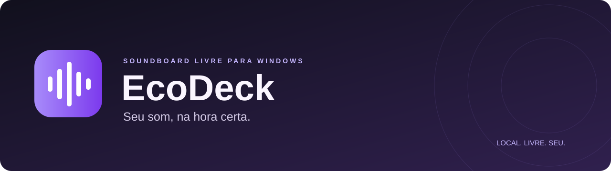

<p align="center"></p>

<p align="center">
  <a href="LICENSE"></a>
  <a href="https://github.com/Toled0o/CrashSounds/releases"></a>
  
  <a href="https://github.com/Toled0o/CrashSounds/actions/workflows/quality.yml"></a>
</p>

**Sua coleção de sons, pronta para a próxima conversa.** Toque reações, efeitos
e vinhetas nos seus fones e em um cabo virtual ao mesmo tempo. Escolha os atalhos
e continue jogando, conversando ou trabalhando.

Gratuito, open source e local. Sem anúncios, conta ou telemetria.

[Releases](https://github.com/Toled0o/CrashSounds/releases) ·
[Microfone virtual](#microfone-virtual-em-5-passos) ·
[Contribuir](CONTRIBUTING.md) · [Changelog](CHANGELOG.md)

> **Primeira versão para testes.** Núcleo e interface têm testes automatizados;
> headset, driver virtual, latência e jogos precisam de validação auditiva no seu
> Windows. O CrashSounds não inclui nem instala drivers.

## Uma olhada no app

Biblioteca central, categorias à esquerda e volumes sempre à mão. Temas claro e escuro.

<!-- ESPAÇOS PARA PRINTS/GIF: descomente quando adicionar os arquivos.


-->

| Espaço reservado | Arquivo para adicionar |
| --- | --- |
| Biblioteca no tema escuro | `assets/screenshots/biblioteca.png` |
| Biblioteca no tema claro | `assets/screenshots/biblioteca-clara.png` |
| GIF: adicionar, atribuir atalho e tocar minimizado | `assets/screenshots/demonstracao.gif` |

Você pode gerar uma prévia fictícia com `python -m ecodeck --smoke-test --screenshot
qa-artifacts/preview.png`. O QA usa apenas áudio sintético; não contém os efeitos
citados nos nomes de exemplo nem acessa seus dispositivos.

## O que já dá para fazer

- Biblioteca MP3/WAV/OGG/FLAC: adicionar, remover, renomear e organizar em categorias.
- Busca por nome/categoria e uma coleção de favoritos.
- Atalhos globais por som, inclusive com o app minimizado.
- Reprodução simultânea nos fones e em uma saída virtual.
- Microfone real misturado ao cabo, sem retorno da sua voz nos fones.
- Volumes individual, geral dos sons e da voz; botão e atalho para parar os sons.
- Exportação/importação de JSON portátil **com os arquivos de áudio incluídos**.
- Bandeja do Windows, início automático opt-in e temas claro/escuro.

O gravador fica no roadmap. A captura atual mistura a voz ao cabo, sem salvar
gravações. O app não modifica drivers ou injeta áudio diretamente em jogos.

## Instalação para usar

**Recomendado: instalador com atalho.**

1. Abra [Releases](https://github.com/Toled0o/CrashSounds/releases) e baixe
   **CrashSounds-0.4.1-setup.exe** (ou o instalador da versão mais recente).
2. Execute o instalador. Ele mostra a licença MIT e instala apenas para sua
   conta em `%LOCALAPPDATA%\Programs\CrashSounds`, sem pedir administrador.
3. Na tela de componentes, mantenha **Criar atalho na área de trabalho** marcado.
   Se quiser, marque **Iniciar com o Windows**; essa opção começa desmarcada.
4. Conclua e abra o CrashSounds pelo **atalho da Área de Trabalho** ou pelo Menu Iniciar.
5. Adicione seus sons, escolha os dispositivos em **Áudio e preferências** e
   clique em **Aplicar e ativar áudio**. Comece com volumes baixos.

Para remover, vá a **Configurações → Aplicativos → Aplicativos instalados → CrashSounds →
Desinstalar**. O desinstalador remove os arquivos e atalhos instalados, mas preserva
sua biblioteca em `%LOCALAPPDATA%\EcoDeck` e arquivos adicionais que você tenha
colocado na pasta. Feche o CrashSounds pela bandeja antes de atualizar ou desinstalar.

### Se o Windows SmartScreen aparecer

Como o instalador ainda não é assinado digitalmente, pode aparecer **“Windows
protegeu seu computador”**. Confira que o arquivo veio da release oficial de
Toled0o/CrashSounds e compare seu SHA-256 com `SHA256SUMS.txt`. Depois clique em
**“Mais informações” → “Executar assim mesmo”**, quando essa opção estiver disponível.
Em um PC gerenciado, a política da organização pode impedir essa opção.
Não é necessário desligar o antivírus.

```powershell
Get-FileHash .\CrashSounds-0.4.1-setup.exe -Algorithm SHA256
```

### Prefere não instalar? Use o portátil

1. Baixe **CrashSounds-windows-x64.zip** na mesma release.
2. Extraia **toda a pasta** para um local permanente, como `D:\Apps\CrashSounds`.
3. Dê dois cliques em **criar-atalho.bat**. Ele cria o atalho na Área de Trabalho
   com o ícone do app; também funciona com Área de Trabalho redirecionada ao OneDrive.
4. Abra pelo atalho ou diretamente por `CrashSounds.exe`.

Não mova o EXE sozinho: `_internal` contém as bibliotecas compartilhadas. Se mover
ou renomear a pasta portátil, execute criar-atalho.bat novamente. O script usa
PowerShell apenas para criar o link, sem mudar sua política de execução permanente.
Para remover o portátil, desmarque início automático no app, saia pela bandeja,
apague o atalho e a pasta extraída. Nenhum Python é necessário para usar os pacotes.

O ícone `assets/CrashSounds.ico` contém resoluções 16, 20, 24, 32, 40, 48, 64, 128 e
256 px. Instalador, EXE, atalhos e bandeja usam o mesmo desenho.
Os pacotes são Windows x64; não há build ARM64 nativo. Para ouvir só nos fones,
deixe a saída virtual desativada.

## Microfone virtual em 5 passos

O caminho recomendado é o [VB-CABLE da VB-Audio](https://vb-audio.com/Cable/index.htm).
É um driver externo, **não é open source**, e tem [licença donationware própria](https://vb-audio.com/Services/licensing.htm),
com condições para uso profissional. O CrashSounds é MIT e não distribui esse driver.

1. **Instale o driver:** baixe do site oficial, extraia, execute o instalador adequado
   como administrador e reinicie o Windows, conforme instruções do fabricante.
2. **Escolha no CrashSounds:** seus fones reais em **Meus fones**, **CABLE Input** em
   **Saída para o cabo virtual** e o microfone do headset/USB em **Meu microfone real**.
3. **Inclua sua voz:** marque **Misturar minha voz na saída virtual**, se quiser, e
   clique em **Aplicar e ativar áudio**. A barra inferior indica quando há captura.
4. **Configure Discord/jogo:** escolha **CABLE Output** como microfone. A saída de
   áudio do Discord continua sendo seus fones físicos.
5. **Faça um teste:** toque um som curto e fale. Você deve ouvir o som nos fones;
   o teste de entrada do Discord recebe o som e, se habilitada, sua voz.

Os nomes parecem invertidos, mas estão certos: enviamos para **CABLE Input** e o
outro app recebe de **CABLE Output**, como explica o [fabricante](https://vb-audio.com/Cable/index.htm).
Não escolha o cabo como microfone real da mixagem. Evite “Escutar este dispositivo”
no Windows: uma segunda rota de monitor pode causar retorno ou duplicação.

Configure os dispositivos em **48.000 Hz**, saída estéreo e captura mono compatível.
Permita acesso ao microfone para aplicativos de área de trabalho nas configurações
de privacidade do Windows. Supressão de ruído e ganho automático do Discord podem
filtrar efeitos: ajuste essas opções durante o teste.

**Parar sons mantém sua voz na chamada. Desativar áudio encerra a captura.**
O volume geral controla os sons, não sua fala. Ao abrir o CrashSounds, mesmo pelo início
automático, o áudio começa desligado até você ativá-lo. Outros drivers que exponham
saída de reprodução e entrada virtual podem funcionar, mas não foram homologados.

## Vídeos e sons a partir de links

1. Clique em **Baixar por link**, na lateral, e cole a URL HTTPS de um vídeo público.
2. Escolha **Salvar vídeo MP4** para selecionar resolução e destino; ou **Trecho de
   áudio para a biblioteca** para informar início, duração (até 120 s) e categoria.
3. Clique em **Baixar**. Acompanhe progresso/velocidade ou use **Cancelar download**.
4. O vídeo fica no destino escolhido. O trecho entra na biblioteca, pronto para
   você atribuir um atalho e tocar quando quiser.

O pacote já inclui yt-dlp, FFmpeg e Node, sem comandos extras para o usuário final.
Compatibilidade depende do site e do vídeo; não há login ou leitura de cookies.
Um vídeo por vez, até uma hora: vídeo até 1 GiB ou fonte de áudio até 256 MiB.
O áudio fonte pode ser baixado por inteiro antes do recorte; um trabalho pode
levar até 15 minutos. Consulte [o guia completo](docs/DOWNLOADER.md).

## Atalhos e uso diário

| Ação | Padrão |
| --- | --- |
| Parar todos os sons | **Ctrl + Alt + Space** |
| Tocar um som | Defina em **Editar**, por exemplo `Ctrl+Alt+1` |
| Tocar pela interface | **Tocar** ou duplo clique na linha |
| Favoritar | Estrela à esquerda |
| Voltar da bandeja | Duplo clique no ícone ou **Abrir CrashSounds** |
| Encerrar de verdade | Menu da bandeja → **Sair** |

Use Ctrl ou Alt com uma letra, número, F1–F24 ou Space. F12 é reservado pelo
Windows. O app usa `RegisterHotKey` com `MOD_NOREPEAT` e não registra o que você
digita. Conflitos aparecem na barra inferior. Jogos com captura exclusiva ou
apps elevados precisam ser testados caso a caso.

Crie ou mova categorias editando o campo **Categoria** do som. Categorias vazias
somem da lateral. Fechar a janela mantém áudio e atalhos na bandeja.

## Seus dados ficam com você

O perfil fica em `%LOCALAPPDATA%\EcoDeck`: `library.json` guarda biblioteca e
preferências; `sounds/` guarda cópias dos áudios. Os originais não são alterados.
Remover um som retira a referência; a cópia local fica para recuperação manual
e ainda ocupa disco. Exporte backups em **Biblioteca → Exportar com os sons**.

Importar substitui a lista após confirmação e validação. Exporte antes.
Dispositivos e captura ficam desativados após importar, para configurar o novo
PC. A opção de início automático já existente no PC é preservada.

Limites: **2.000 sons**, **120 s e 64 MiB por arquivo**, mono/estéreo,
**16 sons simultâneos por destino**, **128 MiB de cache de áudio** e
**128 MiB de originais por exportação**. Base64 deixa o JSON maior que os áudios.
Cache não é a RAM total: Qt, decodificação e importação também usam memória.

O soundboard e sua biblioteca funcionam offline. **Baixar por link** acessa o site
e seus servidores de mídia somente quando você inicia um download. O CrashSounds
não envia sua biblioteca para servidores próprios, não registra um histórico de
URLs e não lê cookies do navegador ou contas. GitHub e badges são serviços externos.

## Instalação para desenvolver

Git e Python **3.11–3.13 x64**. O lockfile e o build foram preparados com Python 3.13.

```powershell
git clone https://github.com/Toled0o/CrashSounds.git
cd CrashSounds
py -3.13 -m venv .venv
.\.venv\Scripts\python.exe -m pip install --require-hashes -r requirements-dev.lock
.\.venv\Scripts\python.exe -m pip install --no-deps -e .
.\.venv\Scripts\python.exe -m ecodeck
```

Não é preciso ativar o ambiente nem mudar a política do PowerShell.
Depois da instalação, `INICIAR.bat` também abre o app. Para outro Python suportado,
instale `pip install -e ".[dev]"` no ambiente correspondente e valide as versões.

```powershell
# Testes sem captura/reprodução em dispositivos reais
.\.venv\Scripts\python.exe scripts/prepare_media_tools.py
.\.venv\Scripts\python.exe -m pytest -q
.\.venv\Scripts\python.exe -m ruff check .
.\.venv\Scripts\python.exe -m ecodeck --smoke-test

# Perfil isolado para teste manual
.\.venv\Scripts\python.exe -m ecodeck --data-dir .\qa-artifacts\perfil-manual

# Gerar executável, ZIP e instalador (NSIS baixado e validado no build)
.\.venv\Scripts\python.exe scripts\build.py
```

O resultado fica em `dist/CrashSounds/CrashSounds.exe`, `dist/CrashSounds-windows-x64.zip` e
`dist/CrashSounds-0.4.1-setup.exe`. O arquivo `SHA256SUMS.txt` cobre ZIP e instalador.
Use `python scripts/build.py --portable-only` para gerar somente o portátil.
O build completo baixa NSIS 3.11 do projeto oficial para `.tools/` e confere
o SHA-256 fixado antes de executar o compilador; nada é instalado globalmente.
FFmpeg e Node já acompanham os pacotes, sem instalação global. O formato onedir mantém DLLs substituíveis; preserve os
[avisos das dependências](THIRD_PARTY_NOTICES.md) ao redistribuir.

```text
src/ecodeck/       modelos, armazenamento, áudio, interface e integração Windows
assets/           banner e espaços para prints
docs/             plano, testes, publicação e continuidade
tests/            áudio sintético, persistência, atalhos e interface offscreen
scripts/          empacotamento Windows
.github/workflows testes em push/PR e executável em releases
```

## Publicar e continuar

Veja [docs/PUBLISHING.md](docs/PUBLISHING.md) para os comandos exatos. Uma release
publicada com tag correspondente à versão, como `v0.1.0`, dispara o workflow
Windows, que testa e anexa o ZIP e SHA-256. O workflow também aceita execução
manual na aba Actions, gerando artifacts sem publicar uma versão.

Para continuar comigo, envie **a URL do repositório, a branch e a mudança desejada**.
Posso clonar, ler `AGENTS.md` e `docs/STATUS.md` e seguir o trabalho via Git.
Em repo privado, conecte a conta com acesso ou autentique o Git no ambiente;
nunca cole tokens ou senhas no chat.

## Roadmap

- [x] Biblioteca, busca, favoritos, atalhos e duas saídas.
- [x] Voz no cabo virtual, volumes, temas e bandeja.
- [x] Exportação portátil e build automatizado.
- [x] Download de vídeo por link e recorte de áudio para a biblioteca.
- [ ] Homologação auditiva de headsets, latência, jogos e desconexões.
- [ ] Gravador com prévia antes de salvar.
- [ ] Normalização opcional, repetição e modos de disparo.
- [ ] Melhorias de acessibilidade e captura visual de atalhos.
- [x] Instalador por usuário e atalhos na Área de Trabalho/Menu Iniciar.
- [ ] Assinatura digital, quando houver estrutura para mantê-la.

## Perguntas frequentes

**Preciso pagar?** O CrashSounds não cobra. Drivers externos têm suas próprias
condições, especialmente para uso profissional.

**Eu ouço, mas a chamada não recebe.** Confira CrashSounds → CABLE Input e Discord →
CABLE Output, os volumes e se a saída virtual está habilitada.

**Há atraso ou estalos.** Usamos WASAPI compartilhado, blocos de 20 ms e buffers
conservadores. A latência depende do hardware; não há garantia de tempo real rígido.
As saídas têm relógios independentes e não são sincronizadas em nível de amostra.
Teste 48 kHz e observe os alertas na barra inferior.

**Troquei o headset e parou.** Selecione o dispositivo novamente e reative o áudio.
O app não redireciona silenciosamente para outro destino quando um nome desaparece.

**Não inicia com o Windows.** Habilite nas preferências, mantenha a pasta no mesmo
lugar e confira se o Windows permitiu CrashSounds em Aplicativos de inicialização.
Desmarque a opção antes de apagar a pasta do app.

**Posso compartilhar os sons?** Só quando você tem permissão para distribuir
cada arquivo. A licença MIT do código não cobre músicas, falas ou efeitos de terceiros.

## Créditos e licença

Criado por **Murilo Siqueira Toledo — [@Toled0o](https://github.com/Toled0o)**.

Copyright (c) 2026 Murilo Siqueira Toledo. Todos os direitos reservados nos termos
da licença MIT. Você pode usar, estudar, modificar e distribuir o código,
inclusive comercialmente, preservando os termos da [LICENSE](LICENSE).

Python, PySide6/Qt, NumPy, sounddevice/PortAudio, SoundFile/libsndfile e
python-soxr/SoXR mantêm suas próprias licenças. Veja [os créditos completos](THIRD_PARTY_NOTICES.md).
Sem vínculo com o Soundpad.

### Atualização de EcoDeck para CrashSounds

Feche o EcoDeck pela bandeja antes de atualizar. O instalador aproveita a instalação
registrada anterior, substitui o executável/atalhos e mantém o início automático
desta instalação. Sons e preferências continuam em %LOCALAPPDATA%\EcoDeck.
Backups .ecodeck.json continuam aceitos. Não apague essa pasta de dados.

O pacote Python interno e o formato do JSON mantêm o identificador ecodeck por
compatibilidade. O nome exibido e os downloads agora são CrashSounds.
